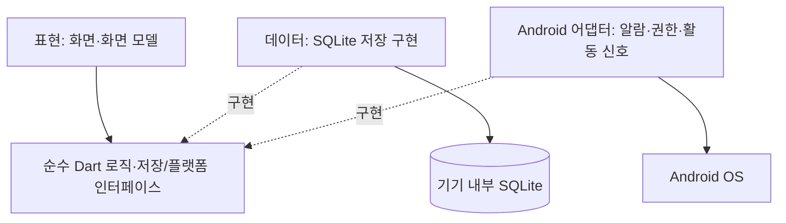

# 수면과 아침 루틴

목표 도착 시각에서 기상·출발·취침 시각을 계획하고, 기상 확인과 준비 루틴으로 아침 시간 관리를 돕는 Android 앱.
현재는 **개발 환경과 초기 화면 구성 단계**이며 핵심 기능을 구현 중이다.

## 1. 문제 정의

- 사용자: 아침 등교·출근 시간을 관리하려는 학생과 직장인.
- 상황과 문제: 늦은 기상과 준비 시간 예측 실패로 지각하거나 수면 시간이 부족해진다.
- 목표: 목표 도착 시각·준비 시간·이동 시간·설정 수면 시간을 바탕으로 계획을 세우고, 실제 기상 확인과 루틴 진행에 따라 예상 도착·지각 시간을 갱신한다.
- 기능 범위·완료 조건·우선순위는 [5주차 계획](docs/week-05.md)과 [7주차 설계](docs/week-07.md)를 따른다.

## 2. 사용자 확인

인터뷰 결과와 성공 기준의 사용자 검증 결과는 아직 이 문서에 정리되지 않았다.
활동지의 문제 가설을 검증된 사용자 결과로 간주하지 않는다.

## 3. 실행 방법

Flutter **3.47.8** / 포함 Dart **3.13.7** / JDK **21** / Android SDK **36**.
SDK 설치·기기 연결·검사·빌드는 [개발 안내](docs/development.md)를 따른다.

```bash
git clone https://github.com/hye6k/aix-2026f-team08.git
cd aix-2026f-team08/app
flutter pub get --enforce-lockfile
flutter run -d <android-device-id>
```

환경변수·API 키·서버는 필요하지 않다. 앱은 `app/`, 수업 활동지는 `docs/`에 있다.
`memo-seed/`는 2주차 실습 자료로 앱과 별개다.

## 4. 아키텍처



실선은 사용 관계, 점선은 인터페이스 구현 관계다. DB와 Android 연동은 후속 구현 대상이다.
알람 해제·기상 후보·사용자 기상 확인을 별도 이벤트로 처리한다.

## 5. 기술 스택과 선택 이유

- Flutter/Dart, Android 우선: 7주차에 확정한 개발 범위.
- SQLite(`sqflite`): 설정·순서가 있는 루틴·실행 기록을 기기 내부에 저장. 스키마는 T03에서 구현한다.
- `ChangeNotifier`/`ListenableBuilder`: 작은 MVP에 맞는 기본 상태 관리. 현재 탭 선택은 화면 내부 상태로 처리한다.
- Kotlin: 플러그인으로 부족한 Android 연동의 확장 지점. 알람·활동 감지 방식은 실기기 실험 후 결정한다.
- 포맷·정적 분석·위젯 테스트·디버그 APK 빌드 검사. 실제 기기 검증 상태는 [별도 기록](docs/android-validation.md)에 남긴다.

## 6. 팀 구성

DataX — 강동혁, 강재환, 박제헌, 오형석.
태스크별 담당은 [5주차](docs/week-05.md), 협업 규칙은 [팀 규칙](docs/team-rules.md)과 [6주차](docs/week-06.md)를 따른다.
AI 산출물의 채택·수정·폐기 근거는 [PROMPTS.md](PROMPTS.md)에 기록한다.

## 7. 라이선스

[MIT](LICENSE).
