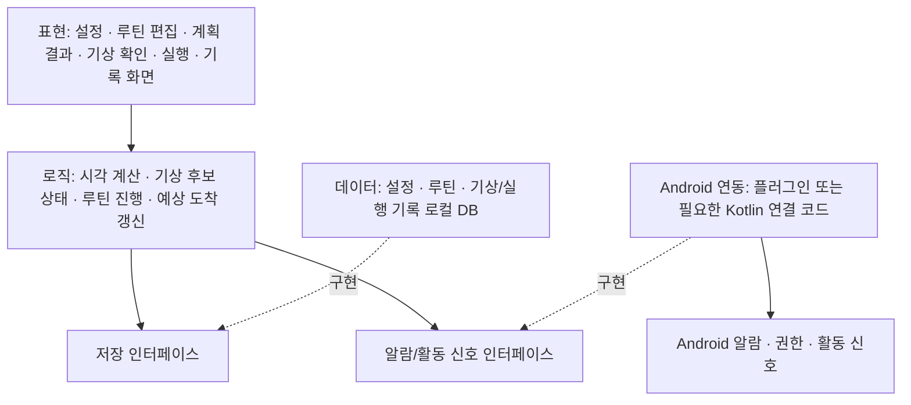

# Week 07 팀 활동지 / Team Activity

| 팀명 / Team | 작성일 / Date | 참여자 / Members |
|---|---|---|
| DataX | 2026년 10월 27일 | 강동혁, 박제헌, 오형석 |

## 1. 아키텍처 다이어그램 / Architecture Diagram

손그림 사진을 올리고 링크하십시오 / Upload a photo and link it.

<!--  -->

### 개발 방향

- Flutter + Dart로 개발하고 Android를 우선 지원한다. iOS 지원은 이번 학기 범위에서 제외한다.
- 기능 범위와 담당은 5주차 계획을 따른다.
- 데이터는 기기 내부 로컬 DB에 저장하는 것으로 계획한다. 별도 서버는 두지 않으며, 회원가입·기기 간 동기화는 구현 범위에서 제외한다.
- DB·상태 관리 도구는 개발 환경 구성 시 선정하고, 알람·활동 신호 플러그인은 실제 기기에서 검증한 뒤 결정한다.

### 계층과 연결

모듈은 아래와 같이 나누고, 실제 파일 구성은 구현하면서 정한다.

실선은 사용 관계, 점선은 인터페이스 구현 관계다. Android 활동 신호는 연동 모듈이 수신해 로직에 전달하고, 로직이 후보 생성·확인·취소를 판단한다.

| 계층 / Layer | 모듈·파일 / Modules | 의존하지 않는 것 / Does not depend on |
|---|---|---|
| 표현 / Presentation | 목표·기상 설정, 루틴 편집, 계획 결과, 기상 확인·실행, 기록 조회 화면 | DB 테이블·SQL과 Android 알람 API를 직접 사용하지 않는다. 계산·상태 판단은 로직에 맡긴다. |
| 로직 / Logic | 취침·기상·출발 시각 계산, 후보 상태 전이, 루틴 진행, 예상 도착·지각 계산, 저장·플랫폼 인터페이스 | Flutter 위젯, 특정 DB 패키지, Android API의 구체 구현에 의존하지 않는다. |
| 데이터 / Data | 설정·루틴·기상 후보/확정·실행 기록의 모델, 로컬 DB, 저장 인터페이스 구현 | 화면 위젯과 화면 이동에 의존하지 않으며, 알람 발생이나 기상 확정 여부를 직접 판단하지 않는다. |

Android 연동은 OS 기능을 다루는 별도 모듈로 둔다. 실제 DB 저장과 OS 알람 예약은 별개이므로, 설정 변경에 따른 예약·취소 결과와 오류를 로직에 반환한다. 기상 후보 감지, 알람 해제, 사용자 기상 확인은 서로 다른 이벤트로 처리한다.

핵심 흐름: 설정·루틴 저장 → 계획 시각 계산 → 알람 예약·발생 → 활동 신호에 따른 기상 후보 → 사용자 확인/취소 → 루틴 진행 → 예상 도착 갱신 → 실행 기록 저장.

## 2. 이슈 / Issues

> 이슈 = **앞으로 할 일** / An issue is work to be done.
> 개발할 때 커밋에 이슈 번호를 붙이고(`#3 알레르기 필터 추가`), 완료 조건을 만족하면 이슈를 닫습니다.
> Add the issue number to commits, and close the issue when its criteria are met.

5주차 태스크를 기준으로 이슈를 정리했다. `T01`~`T19`는 태스크 번호다.
2026-10-28에 T01을 [GitHub 이슈 #4](https://github.com/hye6k/aix-2026f-team08/issues/4)로 등록하고 강동혁(hye6k)을 담당자로 지정했다. 다른 태스크와 분류 라벨은 아직 미등록이며, 등록 후 실제 번호와 링크를 추가한다.

2026-10-31: 기기 독립 공통 계약을 #6으로, 담당 구현·검증 도구를 #7~#14로 세분화해 등록했다. 아래 링크는 각 구현 범위의 이슈이며 원래 태스크의 실기기·UI 통합 완료 조건을 대신하지 않는다. 진행·검증·남은 조건은 [9주차 추가 기록](week-09.md)을 따른다.

T01과 T12부터 착수하며, 이후 순서는 [5주차 의존 관계](week-05.md)를 따른다. 커밋 메시지는 `feat: 기상 후보 확인 기능 추가 (#번호)` 형식으로 작성한다. PR에 관련 이슈를 연결하고, 완료 조건을 만족하여 병합한 뒤 이슈를 닫는다.

| # | 제목 / Title | 라벨 / Label | 담당 / Assignee | 완료 조건 / Acceptance Criteria |
|---|---|---|---|---|
| 예시 #3 | 알레르기 필터 | backend | 홍길동 | '땅콩'을 선택하면 땅콩이 들어간 메뉴가 추천 결과에서 빠진다 |
| T01 / [#4](https://github.com/hye6k/aix-2026f-team08/issues/4) | 개발·시연 플랫폼 및 기본 실행 환경 확정 | chore | 강동혁 | 우선 지원할 플랫폼과 테스트 기기를 정하고 해당 기기에서 기본 앱 화면을 실행한다. 다른 플랫폼 지원 여부를 기록한다. |
| T02 / [#7 검증 도구](https://github.com/hye6k/aix-2026f-team08/issues/7) | 기상 감지 및 알람 가능성 검증 | research | 강동혁 | 선택한 플랫폼에서 화면 켜짐 이벤트 감지와 예약한 시각의 소리·진동 알람을 시험한다. 앱 실행 중·백그라운드·종료 상태별 결과와 필요한 권한·제약을 기록하고, 핵심 사용 상황에 적용 가능한지 판단한다. 적용이 어려우면 대체 감지·알람 방식 또는 범위 변경안을 팀에서 결정한다. |
| T03 / [#8 저장](https://github.com/hye6k/aix-2026f-team08/issues/8) | 설정·기상·루틴·실행 기록 데이터 모델과 저장 기능 구현 | data | 강동혁 | 목표 도착 시각, 이동 시간, 설정 수면 시간, 수동 설정 기상 시각, 기상 시각 적용 방식(권장/수동), 기상 감지 시간 구간, 기상 후보·확정 기록, 루틴 단계, 실행 기록의 구조를 정의한다. 예시 데이터를 저장하고 앱 재실행 후 조회한다. |
| T04 / 미등록 | 목표 시간 및 기상 감지 설정 화면 구현 | ui | 박제헌 | 목표 도착 시각, 이동 시간, 설정 수면 시간, 수동 설정 기상 시각과 기상 감지 시간 구간을 입력·수정·저장하고 다시 불러온다. 권장 기상 시각 사용 또는 수동 설정 사용을 선택할 수 있으며, 빈 입력과 잘못된 값을 안내한다. |
| T05 / 미등록 | 루틴 등록·수정·삭제 화면 구현 | ui | 박제헌 | 루틴명과 단계별 이름·순서·예상 소요시간을 저장한다. 수정·삭제 결과가 다시 조회했을 때 반영된다. |
| T06 / [#9 계산](https://github.com/hye6k/aix-2026f-team08/issues/9) | 기본 시간 계산 로직 구현 | logic | 강동혁 | 사용자 입력값으로 준비 시간과 권장 출발·기상 시각을 계산한다. 기상 시각 적용 방식에 따라 알람 시각을 결정하고, 적용한 기상 시각에서 설정 수면 시간을 빼 취침 시각을 계산한다. 날짜를 포함해 자정을 넘는 경우를 처리하고, 미리 정한 예시의 기대값과 일치한다. |
| T07 / 미등록 | 첫 계획 결과 화면 연결 | ui | 박제헌 | 설정과 루틴을 입력하면 저장된 값을 읽어 권장 출발·기상 시각, 실제 적용할 알람 시각과 이에 따른 취침 시각을 구분하여 표시한다. 필수 입력이 없으면 입력 화면으로 안내한다. |
| T08 / [#10 로직](https://github.com/hye6k/aix-2026f-team08/issues/10) | 기상 후보 감지 및 확인 로직 구현 | logic | 강동혁 | T02에서 채택한 방식으로 설정된 시간 구간의 활동 징후를 감지하여 기상 후보로 기록한다. 후보 취소 후 재감지 조건과 반복 이벤트를 묶는 시간 기준을 정하고, 사용자 확인·취소 및 중복 이벤트 처리 규칙을 구현·검증한다. 수동 기상 입력으로 누락·오탐을 보완하고, 확인 전 후보는 실제 기상 기록으로 확정하지 않는다. |
| T09 / [#11 실행](https://github.com/hye6k/aix-2026f-team08/issues/11) | 루틴 실행 상태 및 기록 로직 구현 | logic | 강동혁 | 확인된 기상 상태에서 루틴을 시작하거나 사용자가 직접 루틴을 시작할 수 있다. 단계 완료·건너뛰기·전체 종료를 처리하고 수행 결과를 저장한다. 수동 루틴 시작만으로 기상 시각을 확정하지 않으며, 기상 확인은 별도로 처리한다. 또한 중복 입력으로 기록이 중복되지 않는다. |
| T10 / [#12 예상](https://github.com/hye6k/aix-2026f-team08/issues/12) | 기상 후보 및 실행 상태에 따른 예상 도착·지각 계산 구현 | logic | 강동혁 | 기상 후보 감지 시 현재 시각을 기준으로 준비를 시작했을 때의 예상 도착·지각 시간을 계산한다. 루틴 실행 후에는 진행 상태에 따라 갱신한다. 기상 확인 전에는 조건부 예상임을 구분하고, 단계별 예상시간 초과 시 남은 시간 계산 규칙을 정하고 검증한다. 예상시간을 넘겼다는 이유로 단계를 자동 완료하지 않는다. |
| T11 / 미등록 | 기상 확인 및 루틴 실행 화면 연결 | ui | 박제헌 | 기상 후보 시각과 확인·취소 조작을 표시한다. 수동 기상 입력, 루틴 시작·단계 완료·건너뛰기·종료가 가능하다. 현재 단계, 경과 시간, 예상 도착·지각 시간을 표시하고, 확인 전에는 “지금 준비를 시작하면”이라는 조건을 표시한다. |
| T12 / 미등록 | 테스트 시나리오·예시 데이터 작성 | test | 오형석, 리뷰: 강동혁 | 알람 발생·해제·다시 울림, 수동 기상 시각 설정, 정상 기상, 늦은 기상, 잠깐 화면을 켠 뒤 후보 취소, 반복 화면 켜짐, 감지 누락과 수동 입력, 지각 예상, 잘못된 입력, 자정 경계 사례의 조작 순서와 기대 결과를 작성한다. T02의 검증 결과에 따라 앱 상태별 사례를 보완한다. |
| T13 / 미등록 | 핵심 흐름 검증 및 발표 시연 준비 | test | 오형석, 결함 수정: 각 구현 담당 | 설정 → 기상 알람 발생 → 기상 후보 감지 → 확인 또는 취소 → 루틴 실행 → 예상 도착·지각 확인 → 완료 및 기록 저장 흐름을 검증한다. 알람 해제·다시 울림과 T12의 실패 사례 및 수동 보완 경로도 확인한다. 실제 감지 시연과 테스트 이벤트를 이용한 시연을 구분하고, 결함 수정 후 재검증한다. |
| T14 / [#11 복구](https://github.com/hye6k/aix-2026f-team08/issues/11) | 기상 확인 및 루틴 실행 상태 복구 구현 | logic | 강동혁 | 앱 재실행 후 미확인 기상 후보와 진행 중인 루틴을 복원한다. 확인·취소한 후보는 다시 미확인 상태로 나타나지 않는다. 앱을 닫아 둔 시간을 경과 시간에 반영하고, 종료한 루틴은 실행 상태로 복원하지 않는다. |
| T15 / [#13 보정](https://github.com/hye6k/aix-2026f-team08/issues/13) | 실제 기록 기반 예상 소요시간 보정 | logic | 강동혁 | 완료한 단계의 실제 소요시간으로 이후 예상시간을 보정한다. 사용할 기록 수, 건너뛴 기록의 제외 여부, 기록 부족 시 기본값 사용 규칙을 정하고 검증한다. |
| T16 / 미등록 | 기상 및 루틴 기록 조회 화면 구현 | ui | 박제헌 | 날짜별 예정·확정 기상 시각, 루틴 수행 여부, 실제 소요시간을 표시한다. 미확인·취소된 후보를 확정 기상 기록과 구분하고, 빈 기록 및 조회 실패 상태를 처리한다. |
| T17 / [#14 조정](https://github.com/hye6k/aix-2026f-team08/issues/14) | 기상 알람 및 기상 확인 요청 구현 | platform | 강동혁, 검증: 오형석 | T02에서 검증한 방식으로 권장 기상 시각 또는 수동 설정 기상 시각에 소리·진동 알람을 제공한다. 다시 울림 간격과 기상 확인 시 예약 취소 규칙을 정하고, 알람 해제·다시 울림을 처리한다. 알람 해제와 기상 확정을 구분한다. 기상 후보 감지 시 확인을 요청하며, 권한 거부 및 설정 변경을 처리하고 중복 알람·요청을 방지한다. 선택한 플랫폼에서 백그라운드·앱 종료 상태별 동작 조건을 검증하고 지원 범위를 명시한다. |
| T18 / 미등록 | 위치 기반 출발·도착 감지 가능성 검증 | research | 강동혁 | 선택한 플랫폼에서 위치 권한, 지정 반경 진입·이탈, 백그라운드 감지를 시험한다. 동작 조건과 한계를 기록하고 적용 여부를 결정한다. |
| T19 / 미등록 | 출발·도착 감지와 실행 기록 연결 | platform | 강동혁 | T18에서 채택한 조건으로 출발·도착 이벤트를 기록한다. 중복 이벤트를 처리하고, 위치 권한이 없으면 수동 출발·도착 입력으로 기록할 수 있다. |

## 3. 마일스톤 / Milestones

마일스톤은 아래 일정으로 계획한다. GitHub에는 아직 등록하지 않았으며, 등록 시 T 번호를 실제 이슈 번호로 연결한다.

| 마일스톤 / Milestone | 마감 / Due | 포함 이슈 / Issues |
|---|---|---|
| MVP 완료 | 11주차 | Must: T01~T13, T17 |
| 실행 패키지 | 13주차 | MVP의 결함 수정·재검증, 실행/설치 안내, Android 시연용 빌드 및 기기·권한·지원 제약 정리 |

- MVP는 설정 → 알람 → 기상 후보 확인/취소 → 루틴 실행 → 예상 도착·지각 확인 → 기록 저장이 Android에서 연결되고, 각 완료 조건과 실패 사례를 검증한 상태로 정의한다.
- 알람·활동 신호의 동작 조건은 실제 기기에서 검증한다. 자동 감지가 필요한 상황에서 동작하지 않으면 대체 방식이나 범위를 다시 정한다.
- Should(T14~T16)는 MVP 완료 후 우선 추가한다. Could(T18~T19)는 여유와 기술 검증 결과에 따라 채택한다. 필수 마일스톤 달성을 지연시키면 제외한다.
- 실행 패키지에는 설치·실행 방법, 테스트 기기·OS와 알려진 제약을 포함한다.

> AI를 사용했다면 `PROMPTS.md`에 기록 / Log any AI use in `PROMPTS.md`
